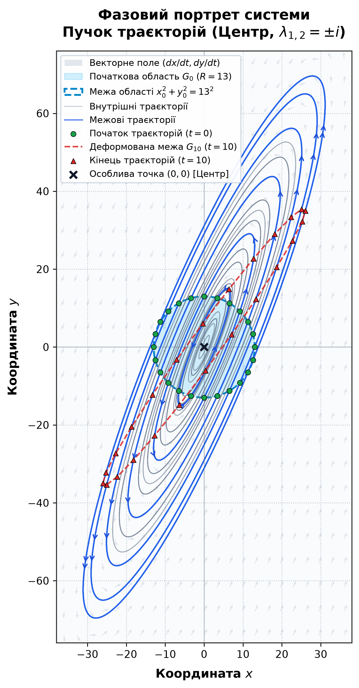
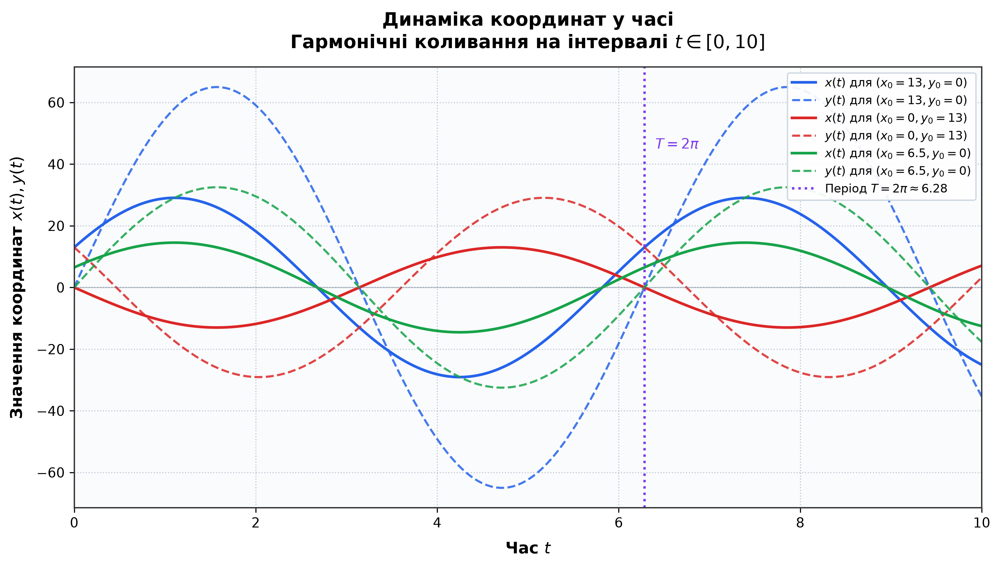

# Моделювання системи диференціальних рівнянь (Варіант 13)

Програма для чисельно-аналітичного моделювання та візуалізації траєкторій лінійної системи звичайних диференціальних рівнянь (СЗДР):

$$\begin{cases} \dfrac{dx}{dt} = 2x - y \\ \dfrac{dy}{dt} = 5x - 2y \end{cases}$$

* **Початкова область:** круг радіуса $R = 13$ ($x_0^2 + y_0^2 \le 13^2$).
* **Інтервал часу:** $t \in [0, 10]$.

Скрипт розраховує рух пучка траєкторій, будує векторне поле швидкостей та генерує два графіки високої якості (300 DPI).

---

## 📁 Структура проєкту

```text
lab1/
├── lab1/
│   ├── lab1.py               # Основний код програми (розрахунки та побудова графіків)
│   └── lab1.pyproj           # Файл проєкту Python для Visual Studio
├── requirements.txt          # Необхідні бібліотеки (numpy, matplotlib)
├── README.md                 # Опис проєкту та інструкція із запуску
├── lab1.sln                  # Файл рішення Visual Studio
├── phase_portrait.png        # Згенерований графік: фазовий портрет
└── time_dynamics.png         # Згенерований графік: часова динаміка x(t), y(t)
```

---

## ⚙️ Як влаштований код (`lab1/lab1.py`)

Скрипт побудований модульно та складається з наступних функцій:

1. **`solve_ode(x0, y0, t)`**
   * Обчислює координати $x(t)$ та $y(t)$ для заданої початкової точки $(x_0, y_0)$ у момент часу $t$:
     $$x(t) = x_0 \cos(t) + (2x_0 - y_0) \sin(t)$$
     $$y(t) = y_0 \cos(t) + (5x_0 - 2y_0) \sin(t)$$
   * Завдяки використанню NumPy функція підтримує як окремі числа, так і векторизовані масиви.

2. **`generate_initial_points(radius=13.0, inner_radii=(3.25, 6.5, 9.75), n_boundary=24, n_inner=16)`**
   * Генерує початкові точки всередині та на межі області $G_0$:
     * 24 точки на зовнішній межі кола радіуса $R = 13$.
     * 48 точок на трьох внутрішніх концентричних колах ($r = 3.25, 6.5, 9.75$).
   * Використовує параметризацію $x_0 = r \cos(\alpha)$, $y_0 = r \sin(\alpha)$ без дублювання кінцевої точки (`endpoint=False`).

3. **`plot_phase_portrait(boundary_points, inner_points, radius=13.0, T=10.0)`**
   * Будує площину $(x, y)$:
     * **Векторне поле:** сітка стрілок швидкостей $(dx/dt, dy/dt)$ з безпечною нормалізацією довжини у центрі $(0,0)$.
     * **Початкова область $G_0$:** зафарбоване блакитне коло з пунктирною межею $R = 13$.
     * **Траєкторії:** сині межові та сірі внутрішні лінії руху зі стрілками напрямку потоку.
     * **Початкові ($t = 0$) та кінцеві ($t = 10$) точки:** зелені маркери та червоні трикутники.
     * **Деформована межа $G_{10}$:** замкнений червоний пунктирний контур положення межі в момент часу $t = 10$ (ілюструє збереження площі області).
     * **Масштаб:** встановлено `ax.set_aspect('equal')`, щоб коло та еліпси не спотворювалися.

4. **`plot_time_dynamics(T=10.0)`**
   * Будує часові графіки коливань координат $x(t)$ (суцільні лінії) та $y(t)$ (пунктирні лінії) на інтервалі $t \in [0, 10]$ для трьох характерних точок:
     * $(13, 0)$
     * $(0, 13)$
     * $(6.5, 0)$
   * Позначає вертикальною фіолетовою лінією період гармонічних коливань $T = 2\pi \approx 6.28$.

5. **`save_figure(fig, filename)`**
   * Зберігає графіки з роздільною здатністю 300 DPI одночасно в папці зі скриптом та в кореневій папці проєкту.

6. **`main()`**
   * Точка входу: налаштовує стилі Matplotlib, запускає генерацію графіків, показує інтерактивні вікна (якщо доступний GUI) та безпечно очищує пам'ять (`plt.close('all')`).

---

## 🚀 Як запустити проєкт на комп'ютері

### Варіант 1. Через термінал (VS Code, PowerShell або CMD)

1. **Перейдіть у папку проєкту:**
   ```bash
   cd c:\Users\Alex\source\repos\lab1
   ```

2. **Активуйте віртуальне середовище (якщо воно вже створене):**
   * *Windows (PowerShell):*
     ```powershell
     .venv\Scripts\Activate.ps1
     ```
   * *Windows (CMD):*
     ```cmd
     .venv\Scripts\activate.bat
     ```
   *(Якщо середовища немає, створіть його командою `python -m venv .venv` та активуйте).*

3. **Встановіть залежності:**
   ```bash
   pip install -r requirements.txt
   ```

4. **Запустіть скрипт:**
   ```bash
   python lab1\lab1.py
   ```
   або напряму через інтерпретатор середовища:
   ```bash
   .venv\Scripts\python.exe lab1\lab1.py
   ```

---

### Варіант 2. Через Visual Studio

1. Відкрийте файл рішення **`lab1.sln`** у Visual Studio.
2. У вікні *Solution Explorer* переконайтеся, що для проєкту `lab1` вибрано оточення Python (`.venv`).
3. Натисніть **F5** (запуск із налагодженням) або **Ctrl + F5** (запуск без налагодження).
4. Програма згенерує зображення та відкриє інтерактивні вікна з графіками.

---

## 📊 Результати роботи програми

Після виконання скрипту в корені проєкту створюються два графічні файли:

### 1. Фазовий портрет системи (`phase_portrait.png`)
Показує фазову площину $(x, y)$, сім'ю еліптичних траєкторій навколо особливої точки типу "центр", початковий круг $G_0$ та деформовану область $G_{10}$ при $t = 10$:



### 2. Динаміка координат у часі (`time_dynamics.png`)
Показує незатухаючі гармонічні коливання координат $x(t)$ та $y(t)$ на проміжку $t \in [0, 10]$ зі спільним періодом $T = 2\pi \approx 6.28$:


