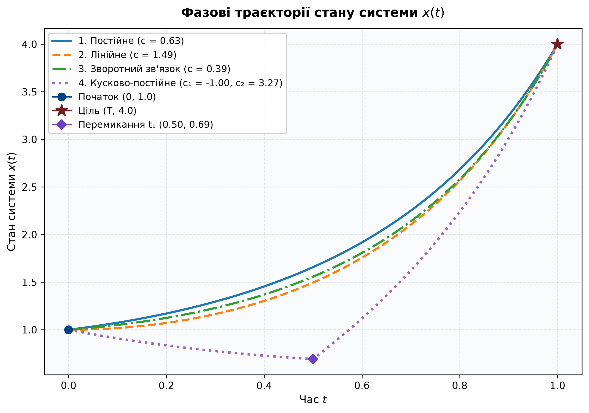
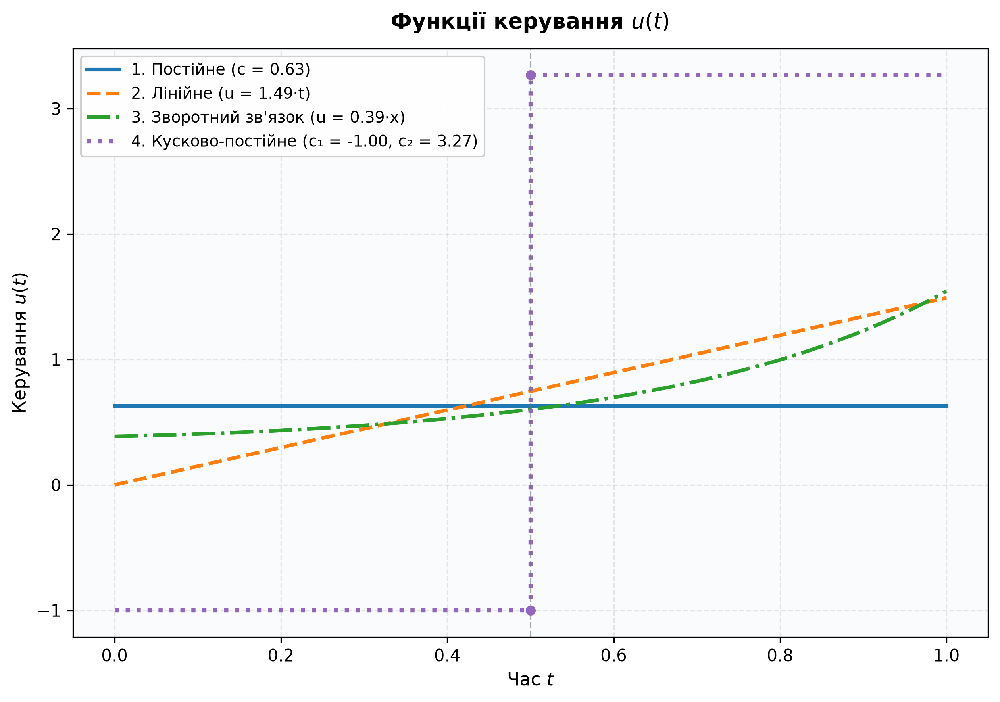

# Лабораторна робота №2: Керування лінійною нестаціонарною системою

Програма для чисельного моделювання та візуалізації задачі оптимального/програмного керування лінійною нестаціонарною динамічною системою.

---

## 📌 Математична постановка задачі

Динамічна система описується диференціальним рівнянням першого порядку:

$$
\frac{dx}{dt} = 2tx + u(t), \quad t \in [0, T], \quad T > 0
$$

З крайовими умовами:

$$
x(0) = x_0, \quad x(T) = y_0
$$

Необхідно перевести динамічну систему з початкового стану $x_0$ у кінцевий цільовий стан $y_0$ за час $T$ для чотирьох різних класів керувань $u$:

---

### 1. Постійне керування: $u(t) = c$

* **Константа керування:**

$$
c = \frac{y_0 e^{-T^2} - x_0}{I(0, T)}
$$

* **Траєкторія стану:**

$$
x(t) = e^{t^2} \left(x_0 + c \cdot I(0, t)\right)
$$

де інтеграл Гаусса:

$$
I(a, b) = \int_a^b e^{-s^2} ds = \frac{\sqrt{\pi}}{2} \left(\text{erf}(b) - \text{erf}(a)\right)
$$

---

### 2. Програмне лінійне керування: $u(t) = c \cdot t$

* **Константа керування:**

$$
c = \frac{2 \left(y_0 - x_0 e^{T^2}\right)}{e^{T^2} - 1}
$$

* **Траєкторія стану:**

$$
x(t) = x_0 e^{t^2} + \frac{c}{2} \left(e^{t^2} - 1\right)
$$

---

### 3. Керування зі зворотним зв'язком: $u(x) = c \cdot x$

> [!NOTE]
> Необхідна умова застосовності методу: $x_0 \cdot y_0 > 0$.

* **Константа зворотного зв'язку:**

$$
c = \frac{1}{T} \ln\left(\frac{y_0}{x_0}\right) - T
$$

* **Траєкторія стану:**

$$
x(t) = x_0 \exp\left(t^2 + c t\right)
$$

* **Функція керування:**

$$
u(t) = c \cdot x(t)
$$

---

### 4. Кусково-постійне керування

Функція керування задається сходинкою на двох інтервалах часу при $0 < t_1 < T$ та $c_1 \ne c$:

$$
u(t) = 
\begin{cases} 
c_1, & t \in [0, t_1] \\ 
c_2, & t \in (t_1, T] 
\end{cases}
$$

* **Константа $c_1$:** задається явно (наприклад, $c_1 = -1.0$).
* **Константа $c_2$:**

$$
c_2 = \frac{y_0 e^{-T^2} - x_0 - c_1 \cdot I(0, t_1)}{I(t_1, T)}
$$

* **Траєкторія стану $x(t)$:**

$$
x(t) = 
\begin{cases} 
e^{t^2} \left(x_0 + c_1 \cdot I(0, t)\right), & t \in [0, t_1] \\ 
e^{t^2} \left(x_0 + c_1 \cdot I(0, t_1) + c_2 \cdot I(t_1, t)\right), & t \in (t_1, T] 
\end{cases}
$$

---

## 📊 Результати розрахунків для базових параметрів

При $x_0 = 1.0$, $y_0 = 4.0$, $T = 1.0$, $t_1 = 0.5$, $c_1 = -1.0$:

| Клас керування | Константи керування | Кінцевий стан $x(T)$ | Абсолютна похибка $\|x(T) - y_0\|$ |
| :--- | :--- | :--- | :--- |
| **1. Постійне** | $c \approx 0.631364$ | $4.000000$ | $0.00 \times 10^0$ |
| **2. Програмне лінійне** | $c \approx 1.491860$ | $4.000000$ | $0.00 \times 10^0$ |
| **3. Зворотний зв'язок** | $c \approx 0.386294$ | $4.000000$ | $0.00 \times 10^0$ |
| **4. Кусково-постійне** | $c_1 = -1.0, \; c_2 \approx 3.266753$ | $4.000000$ | $0.00 \times 10^0$ |

*Стан у момент перемикання:* $x(t_1) = x(0.5) \approx 0.691729$.

---

## 📈 Візуалізація

### 1. Траєкторії стану $x(t)$


### 2. Функції керування $u(t)$


---

## 📁 Структура папки

```text
lab2/
├── lab2-program/
│   ├── lab2.py               # Повний самодостатній скрипт моделювання та візуалізації
│   └── requirements.txt      # Необхідні бібліотеки (numpy, scipy, matplotlib)
├── state_trajectories.png    # Графік траєкторій стану x(t)
├── control_functions.png     # Графік функцій керування u(t)
├── Лаб2 Удс .pdf             # Вирішення задачі аналітичним способом
└── README.md                 # Математичний опис та інструкція
```

---

## 🚀 Запуск скрипта

1. Встановіть необхідні залежності:
   ```bash
   pip install -r lab2-program/requirements.txt
   ```

2. Запустіть програму:
   ```bash
   python lab2-program/lab2.py
   ```
